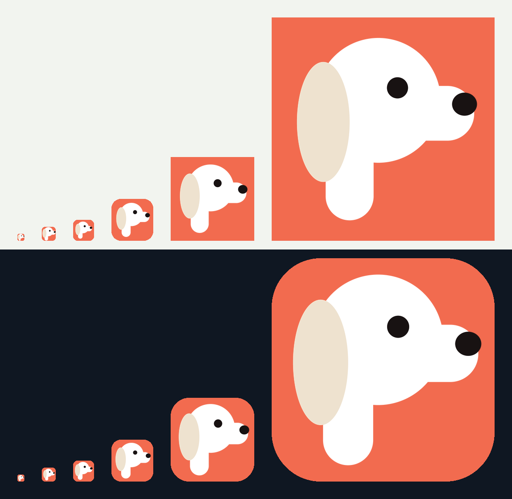
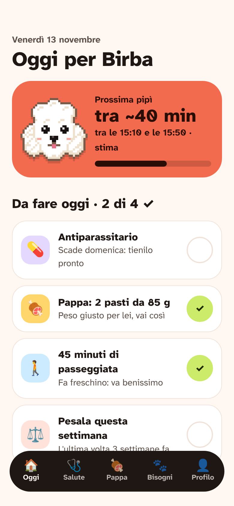
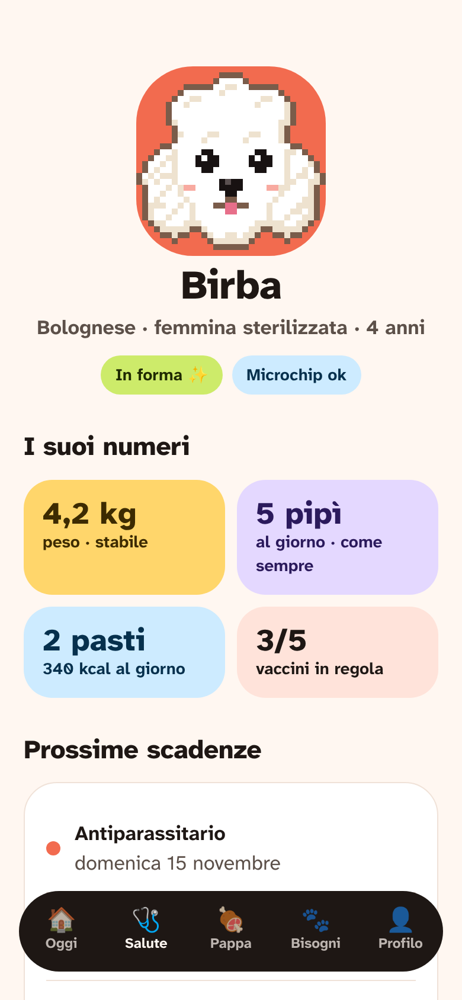
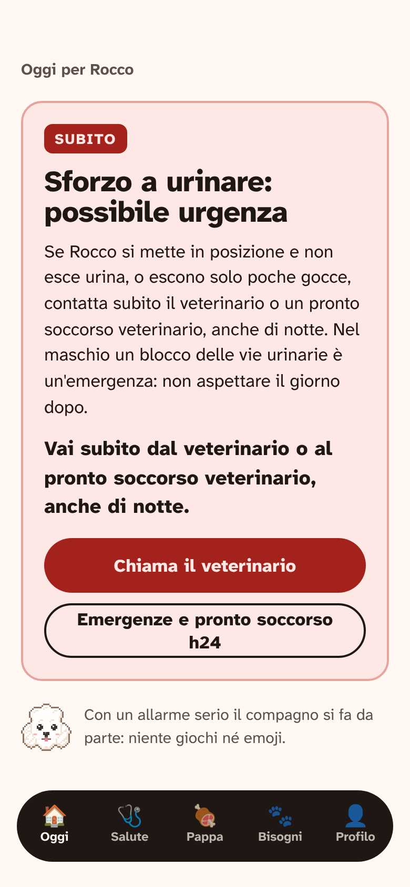
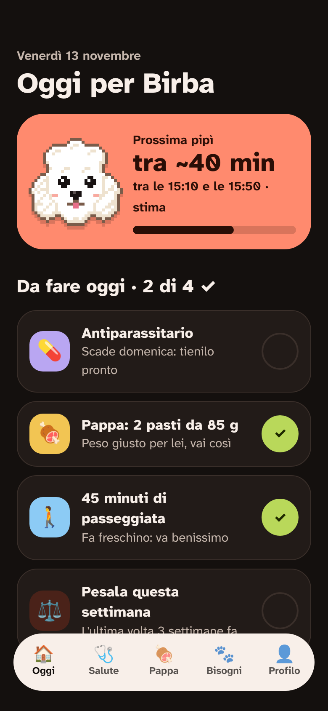
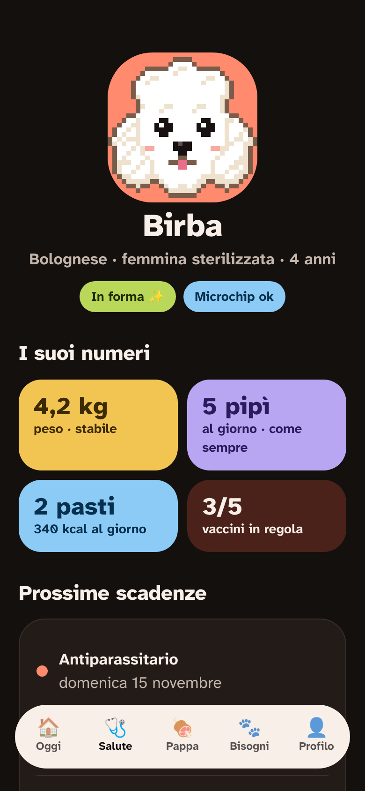
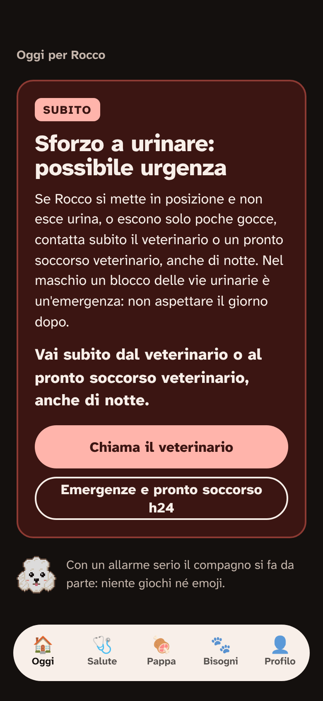

# Lulù: web app installabile e APK Android — rapporto

> **Nota (13/11, notte):** l'app ora si chiama **Pellovi**; «Lulù» è il nome della mascotte, il
> bolognese in pixel art. Il nome sta in `lib/brand.dart` (`appName`, `mascotName`). In questo
> rapporto «Lulù» indica l'app nelle sezioni scritte prima del cambio.

Branch `claude/debug-completo` (nessun push precedente, ma ho tenuto questo nome perché è l'unico
su cui questa sessione è autorizzata a fare push). Niente merge su `main`, niente tag, niente
pubblicazioni.

## ⚠️ Prima di tutto: cosa NON ho potuto eseguire

In questo ambiente **Flutter non si installa**: la rete blocca `storage.googleapis.com` (da dove
Flutter scarica Dart e il motore) e `pub.dev` (pacchetti). Quindi **non ho potuto eseguire
`flutter analyze`, `flutter test`, `flutter build web` né `flutter build apk`.**

Cosa ho fatto al posto loro:

- ho letto il sorgente di **Flutter 3.47.9** (la versione della CI, scaricato da GitHub) per
  verificare le opzioni usate (`--base-href`, `--no-web-resources-cdn`, `--build-name`,
  `flutter_bootstrap.js` personalizzato) e il comportamento del service worker;
- ho letto il sorgente di **share_plus 13.3.1** per il comportamento sul web;
- ho riletto riga per riga tutto il codice Dart cambiato (import, lint, `const`);
- ho provato la parte web con **Playwright** su una build simulata (stessi file di `web/`, con un
  finto `main.dart.js`), servita in una sottocartella `/lulu/`;
- ho controllato la sintassi di `sw.js`, `flutter_bootstrap.js`, dei workflow YAML e degli script.

**Da fare subito:** aprire una PR (o lanciare la CI) così `ci.yml` esegue `flutter analyze`,
`flutter test` e la nuova build web; oppure, in locale, `flutter analyze && flutter test &&
tool/build_web.sh && flutter build apk --release`. Se qualcosa non compila, è con ogni probabilità
in `lib/ui/device_notice.dart`, `lib/store.dart` (tetto foto) o `test/web_pwa_test.dart`.
Per far girare Flutter anche nelle sessioni cloud bisogna consentire nella rete dell'ambiente
`storage.googleapis.com` e `pub.dev`.

## Cosa ho fatto

### 1. Nome: da Zampa a Lulù

- Tutto ciò che vede l'utente: `lib/brand.dart` (da qui il nome arriva in quasi tutte le schermate,
  nel PDF e nei promemoria), testi clinici e traduzioni (`app_it.arb` e file generati),
  `android:label`, nomi su iOS, `web/manifest.json`, `web/index.html`, README, INSTALLA, DOSSIER,
  documenti privacy e clinici, lettera al veterinario. Test e snapshot aggiornati di conseguenza.
- Nomi dei file senza accento, per evitare problemi con email e vecchi sistemi:
  `Lulu_<cane>_<data>.pdf`, `lulu-backup-<data>.json`, `lulu.apk`.
- **Lasciati apposta come «zampa»:** `applicationId`/bundle id `it.zampa.zampa`, nome del
  pacchetto Dart (`package:zampa/…`), chiavi di salvataggio (`zampa_v1`, `zampa_consent_…`) e
  canale notifiche: cambiarle farebbe perdere i dati a chi ha già l'app.
- Lasciati i rapporti storici in `ricerca/` (documentano decisioni passate) e i nomi delle app
  desktop (Windows/macOS/Linux, non più un obiettivo).

**applicationId: conviene cambiarlo?** Sì, ma **solo prima di distribuire l'APK a persone vere**.
Per Android un applicationId diverso è un'app diversa: chi ha installato la vecchia avrebbe due
app, e i dati non passano dall'una all'altra. Oggi, con pochi tester, il costo è minimo; dopo
cresce. Va scelto insieme al marchio definitivo (es. `it.<dominio>.lulu`) e insieme alla chiave di
firma. Il bundle id iOS non serve più (niente App Store). Se decidi, è una modifica di due righe
in `android/app/build.gradle.kts` (`namespace`, `applicationId`) più lo spostamento di
`MainActivity.kt`.

### 2. Web app installabile (PWA)

- `web/manifest.json`: nome e nome breve, descrizione, lingua, `start_url`/`scope` relativi (così
  funziona con qualunque base href), colori del tema, icone normali e **maskable** 192/512.
- `web/index.html`: meta per iPhone (`apple-mobile-web-app-*`, `apple-touch-icon` 180×180),
  `theme-color`, viewport con le aree sicure, schermata «Lulù si sta aprendo…» con tema scuro,
  richiesta di **archiviazione persistente** (riduce il rischio che il browser cancelli i dati).
- **Logo nuovo: il muso di un bolognese in pixel art** (griglia 32×32 disegnata in codice,
  `tool/gen_icons.py`): pelo bianco a fiocchi con ombre crema, orecchie lunghe che scendono ai
  lati, occhi tondi neri con un punto di luce, tartufo nero, lingua e guance rosa, contorno
  marrone caldo su fondo **corallo** (`#F26B4F`). Ingrandito sempre per multipli interi senza
  smussare (solo le icone sotto i 32 px, 16/20/29, sono ridotte). Da quel disegno escono tutte le
  icone: web (favicon 32, 192, 512, maskable 192/512 con margine di sicurezza, apple-touch-icon
  180), Android (mipmap classiche e **icona adattiva** con foreground e colore di fondo), iOS,
  macOS e Windows (.ico). Prima c'era il logo Flutter predefinito.
  Anteprima affiancata (16, 32, 48, 96, 192, 512 px, fondo chiaro e scuro):
  
- **Uso offline (`web/sw.js`)**: scoperta importante — in Flutter 3.47 il service worker generato
  da Flutter **si disinstalla da solo**, quindi finora l'app web non funzionava offline. Ora:
  `web/flutter_bootstrap.js` non lo registra più, e `sw.js` salva tutti i file dell'app alla prima
  apertura (prima la rete per la pagina, poi la copia salvata; per il resto prima la copia).
  A ogni nuova versione la cache cambia nome (impronta del contenuto) e la vecchia si cancella.
- **CanvasKit dal nostro sito** (`--no-web-resources-cdn`): prima il motore grafico veniva
  scaricato da `gstatic.com` (Google) a ogni avvio; ora viene dal nostro hosting, necessario per
  l'offline e meglio per la privacy.
- **Prova con Playwright (iPhone 13 e Pixel 7, chiaro e scuro, sito in `/lulu/`)**: service worker
  attivo e in controllo, manifest letto, 13 file in cache, **ricarica offline riuscita** (anche
  con un percorso `#/…`), pagina di download senza scorrimento orizzontale a 390 px, sezione
  giusta in evidenza per iPhone e per Android, APK scaricabile, nessun errore in console.
  ⚠️ Con il finto `main.dart.js`: l'app Flutter vera nel browser non l'ho potuta aprire.

### 3. Funzioni che sul web non vanno (controllate una per una)

| Funzione | Sul web / iPhone | Cosa succede ora |
|---|---|---|
| Notifiche (`flutter_local_notifications`) | non esistono | Già disattivate in modo sicuro. **Nuovo:** la Home avvisa una volta che promemoria, dosi e allarmi si vedono solo aprendo l'app, e consiglia Android o «Aggiungi alla schermata Home». Prima l'utente web credeva di essere avvisato. |
| Fuso orario (`flutter_timezone`) | non usato | Chiamato solo se le notifiche sono supportate. Nessun crash. |
| Foto (`image_picker`) | funziona (fotocamera/galleria del browser) | **Bug corretto:** le foto erano salvate in base64 nel localStorage (~5 MB in tutto). Riempito quello, **non si sarebbero più salvati nemmeno cani, diari e terapie**. Ora sul web le foto hanno un tetto di ~1,5 MB con messaggio chiaro; su Android nessun limite. |
| Backup (`share_plus`) | iPhone: foglio di condivisione; computer: scarica il file | Verificato nel sorgente: se la condivisione non c'è, scarica il file. Ok. |
| PDF per il veterinario (`printing`) | scarica il PDF | Ok. |
| Accesso con Apple/Google | sul web usa il reindirizzamento OAuth | Funziona se in Supabase si aggiunge l'indirizzo della web app tra i «Redirect URLs». |
| «Apri Impostazioni» delle notifiche | non esiste | Già escluso sul web. |
| Telefono veterinario/emergenze (`tel:`) | su iPhone apre la chiamata | Ok. |
| Emoji nel testo | il motore le scarica da `fonts.gstatic.com` | Offline al primo uso possono mancare; contatto con Google (vedi decisioni). |

Aggiunto anche **Profilo › Installa Lulù sul telefono** (solo nella web app), che apre la pagina di
download.

**Web Push per i promemoria — proposta, NON implementata.** Si può fare, con questi limiti:
su iPhone funziona solo da iOS 16.4 e solo con l'app **aggiunta alla schermata Home**; il
permesso va chiesto dopo un tocco dell'utente. Serve un piccolo server che invii i messaggi all'ora
giusta, perché il browser non sa programmare notifiche locali come fa Android. Proposta:
1. chiavi VAPID; nel `sw.js` gestione di `push` e `notificationclick`;
2. iscrizione salvata in una tabella Supabase (`push_subscriptions`, legata all'account, quindi
   **solo per chi ha l'account**);
3. l'app invia al server l'elenco dei promemoria già calcolati (stessi testi di Android);
4. una Edge Function Supabase lanciata ogni minuto da `pg_cron` invia quelli scaduti
   (libreria `web-push`).
Costo: gratis nel piano Supabase; 2-4 giorni di lavoro. Implicazioni privacy: i promemoria
(nomi dei farmaci, orari) andrebbero sul server → aggiornare informativa, DPIA e registro.
Alternativa più leggera: notifiche solo mentre l'app è aperta. Decidi tu.

### 4. APK

- `android/app/build.gradle.kts`: firma di rilascio letta da `android/key.properties` (mai nel
  repository, già in `.gitignore`); senza, chiave di debug come prima.
- **`.github/workflows/release.yml`** (a ogni tag `v*`, oppure a mano senza Release): analisi,
  test, APK universale + APK solo 64 bit, web app con l'APK dentro, **GitHub Release** con
  `lulu.apk`, `lulu-universale.apk`, `lulu-web.zip`. Versione presa dal tag, `versionCode`
  crescente. Firma dai segreti `ANDROID_KEYSTORE_BASE64`, `ANDROID_KEYSTORE_PASSWORD`,
  `ANDROID_KEY_ALIAS`, `ANDROID_KEY_PASSWORD`.
- `android.yml` produce ora `lulu.apk`/`lulu-arm64.apk`; `ci.yml` compila anche la web app.
- `flutter build apk --release` **non verificato qui** (vedi sopra). In CI su `main` il workflow
  Android lo eseguiva già con successo prima di queste modifiche; i cambi lato Android sono il
  nome, le icone e la firma facoltativa.

### 5. Pagina di download

`web/download.html` (anche da Profilo): pulsante **«Scarica per Android (APK)»** con i passaggi
(consentire l'installazione, Play Protect, notifiche), istruzioni **iPhone** con
«Condividi › Aggiungi alla schermata Home», sezione computer. Mette in evidenza la parte del
telefono in uso, tema chiaro e scuro, testo grande, nessuna dipendenza esterna.

### 6. Hosting

La build è indipendente dall'hosting: `BASE_HREF=/sottocartella/ tool/build_web.sh` (o la
variabile di repository `LULU_BASE_HREF` nel workflow), percorsi tutti relativi, rotte con `#`
(nessuna regola di riscrittura necessaria). Basta caricare il contenuto di `build/web` (o di
`lulu-web.zip`). Serve HTTPS. `web/_headers` imposta la cache giusta per `sw.js` e `index.html`
su Cloudflare e Netlify.

**Proposta: Cloudflare Pages.** Gratis con repository privato, banda illimitata, HTTPS e dominio
personalizzato, legge `_headers`, caricamento anche diretto dello zip (senza collegare GitHub).
Unico limite: **file fino a 25 MiB** → per questo sulla pagina va l'APK solo 64 bit (quasi tutti
i telefoni dal 2017); il workflow avvisa se lo supera.
- *Netlify*: va bene uguale, ma il piano gratuito ha limiti di banda/crediti più stretti e
  scaricare l'APK li consuma.
- *GitHub Pages con repo pubblico*: sconsigliato, renderebbe pubblici codice, ricerche,
  documenti legali e il tuo nome nei documenti privacy.
- Nota: con il repo privato **gli allegati delle GitHub Release non sono scaricabili da chi non
  ha accesso**; per questo l'APK pubblico sta sull'hosting della web app.

## Decisioni che spettano a Lorenzo

1. **Marchio «Lulù»**: `ricerca/13-nome-e-marchio.md` lo dava a **rischio alto** (migliaia di
   marchi «lulu», app omonime, l'accento negli store). Conviene una verifica prima di investirci.
2. **applicationId** definitivo (vedi sopra): meglio deciderlo prima di dare l'APK in giro.
3. **Chiave di firma Android**: va creata una volta (`keytool -genkey …`), salvata in un posto
   sicuro e messa nei segreti di GitHub. Senza, ogni APK della CI ha una chiave diversa e **gli
   aggiornamenti non si installano sopra la versione precedente** (bisogna disinstallare e si
   perdono i dati). Se la chiave si perde, stesso problema.
4. **Hosting** (proposta Cloudflare Pages) e dominio.
5. **Web Push** sì/no (proposta sopra).
6. **Logo**: va bene il bolognese corallo? Si cambia in `tool/gen_icons.py` e si rigenera tutto.
7. **Privacy per il web**: l'informativa parla di dati «sul telefono»; sul web sono nel browser.
   Il motore grafico scarica ancora i caratteri di riserva (emoji) da `fonts.gstatic.com`:
   da citare nell'informativa o da eliminare includendo un font emoji nell'app (+ peso).
8. Indirizzo della web app tra i **Redirect URLs** di Supabase (per Apple/Google sul web).

## Problemi trovati e NON corretti

- **Manca il ripristino del backup.** «Esporta i miei dati» crea il file, ma nell'app non c'è
  un'importazione. Sul web, dove il browser può cancellare i dati, è il rischio più serio.
  Lavoro di qualche ora, con test; non l'ho fatto perché fuori dal compito.
- **Sul web tutti i dati stanno nel localStorage** (limite ~5 MB, cancellabile da Safari dopo
  settimane senza uso se l'app non è sulla Home). Il tetto alle foto protegge i dati di oggi;
  la soluzione vera è IndexedDB per le foto. Da pianificare.
- Il salvataggio principale (`_save` in `store.dart`) non segnala all'utente un eventuale errore
  di scrittura: oggi è improbabile grazie al tetto, ma resterebbe silenzioso.
- Il primo «debug completo» richiesto prima è stato sospeso per il cambio di compito.

## Esito di test e build

| Controllo | Prima | Dopo |
|---|---|---|
| `flutter analyze` / `flutter test` / build web / build APK | non eseguibili qui (Flutter non installabile) | non eseguibili qui: **da far girare in CI** |
| Test nuovi | — | `test/web_pwa_test.dart`: nome, manifest, icone, meta iPhone, service worker, pagina di download, avviso notifiche (3 casi), tetto foto (2 casi) |
| Test aggiornati | — | `privacy_test` (nome backup e informativa), `review3_test` e snapshot dei testi clinici (nome) |
| PWA con Playwright (iPhone 13, Pixel 7, chiaro/scuro, in `/lulu/`) | offline assente (SW di Flutter auto-disinstallante) | SW attivo, 13 file in cache, ricarica offline ok, nessun errore |
| `tool/pwa_finalize.py` su build simulata | — | lista offline corretta (esclude APK, skwasm, mappe), versione scritta in download.html |
| Sintassi JS, YAML dei workflow, script bash | — | ok |

---

## Blocchi B, C e D (richieste successive di Lorenzo)

**Ostacolo comune:** B, C e D richiedono molto codice Dart nuovo (iscrizione Web Push, nuovo
tema e nuovi widget in tutte le schermate, motore di consigli). Qui Flutter non si installa, per
cui quel codice **non si può compilare né testare**, e la condizione «`flutter analyze` e
`flutter test` devono passare» non sarebbe verificabile. Ho fatto le parti verificabili; il resto
è pronto da implementare appena Flutter funziona (rete: `storage.googleapis.com` e `pub.dev`).

### B. Tutte le funzionalità su web e iPhone

Elenco funzione per funzione, con lo stato prima e dopo (Android / web / iPhone), e progetto
dei promemoria Web Push (service worker, Supabase Edge Function con `pg_cron`):
[`docs/FUNZIONI-PIATTAFORME.md`](docs/FUNZIONI-PIATTAFORME.md). Nessuna funzione è stata tolta.
Restano da fare Web Push (decisione di privacy: i promemoria passerebbero dal server), il
ripristino del backup e le foto in IndexedDB.

### C. Interfaccia moderna: proposta prima di applicarla

Tre schermate di prova in chiaro e scuro (HTML reso con Playwright, `docs/design/mockup.html`):
corallo, lime, lilla e cielo, angoli molto arrotondati, titoli grossi in Atkinson ExtraBold, card
grandi, il bolognese come compagno, testi del tu con qualche emoji. **Mai emoji negli allarmi**,
dove il compagno si fa da parte. Tutte le coppie di colori superano AA (minimo 6:1). Pulsanti alti
52 px, voci di menu di almeno 48 px.

| Home «Oggi per Birba» | Scheda del cane | Allarme SUBITO |
|---|---|---|
|  |  |  |
|  |  |  |

Il testo dell'allarme è quello vero dell'app, rivisto dai veterinari. Da approvare prima di
riscrivere `lib/ui/theme.dart` e le schermate.

### D. Lulù più intelligente

[`docs/ASSISTENTE.md`](docs/ASSISTENTE.md):
- **D1, consigli «Oggi per <nome>»**: regole e priorità progettate sui moduli esistenti
  (prevenzione, stagione, nutrizione, peso, bisogni, diari); implementazione in attesa di Flutter.
- **D2, assistente con l'API di Claude**: architettura con Supabase Edge Function (la chiave mai
  nell'app), prompt di sistema con le regole di sicurezza e l'uso degli allarmi già rivisti, limiti
  d'uso (20 al giorno, 200 al mese), consenso separato. Costo stimato per utente al mese con uso
  medio: ~0,55 $ con Opus 5.5, ~0,27 $ con Sonnet 5.5, ~0,02 $ con Haiku 5.5.
  **Non attivato, nessuna chiave chiesta**: decide Lorenzo.

---

## Aggiornamento: collaudo con Flutter vero (13/11, sera)

La rete ora permette di installare Flutter 3.47.9 (clonato da GitHub, scaricando
`storage.googleapis.com` e `pub.dev`).

| Controllo | Prima (commit `9d28010`) | Dopo (questo branch) |
|---|---|---|
| `flutter analyze --fatal-infos` | nessun problema | nessun problema (corretto un import mancante in `test/web_pwa_test.dart`) |
| `flutter test` | 159 passati, 22 saltati | **172 passati** (159 + 13 nuovi), 22 saltati |
| `dart format` | — | nessuna modifica necessaria |
| `tool/build_web.sh` (base href `/lulu/`) | — | ✅ build riuscita |
| `flutter build apk --release` | — | ✅ **riuscita**: `app-release.apk` universale da 72,0 MB (dopo aver dato alla piattaforma dell'SDK di questa macchina il nome «android-37» atteso dal plugin Android; il codice non è cambiato). La versione solo 64 bit, quella per la pagina di download, non l'ho ancora generata |

**Collaudo Playwright sull'app vera** (a misura iPhone 13, chiaro e scuro, servita in `/lulu/`):
schermata iniziale e avvertenze, cane di esempio, tutte le schede, procedura guidata con un cane vero,
avviso «PROMEMORIA» (compare, «Ho capito» lo nasconde anche dopo la ricarica), dati salvati dopo la
ricarica, **apertura offline con i dati**, Emergenze, Privacy e informativa, esportazione
(`lulu-backup-2026-11-13.json` con il cane dentro), link «Installa Lulù sul telefono» → `download.html`.
Nessun errore JavaScript.

**Correzioni nate dal collaudo:**
- **Privacy:** il plugin `google_sign_in` caricava lo script di Google (`accounts.google.com`) a ogni
  avvio, anche senza account; sul web non serve, perché l'accesso Google passa da Supabase. Ora una
  Content-Security-Policy in `index.html` lo blocca (verificato: richiesta bloccata, nessun'altra
  richiesta verso terzi). Se Supabase userà un dominio personalizzato, va aggiunto alla policy.
- **Uso offline più leggero:** Flutter 3.47 contiene 5 varianti del motore grafico. Prima si salvavano
  tutte (29 MB); ora si salva l'involucro (7,4 MB) e, dopo il primo disegno, solo la variante usata
  davvero dal browser.

**Difetto preesistente notato (non corretto):** nell'informativa gli a capo del file `.md` spezzano le
frasi degli elenchi su più paragrafi.

Prossimi passi, sospesi per la pausa: il blocco B (Web Push, approvato).
Per il blocco C le schermate di prova sono pronte in `docs/design/` e aspettano l'ok di Lorenzo.

## Aggiornamento: blocco B fatto (Web Push, foto, collaudo)

Dettagli e tabella funzione per funzione: [`docs/FUNZIONI-PIATTAFORME.md`](docs/FUNZIONI-PIATTAFORME.md).

- **Web Push** completo: app, database (17 test SQL), Edge Function (3 test Deno), service worker
  (notifica provata in Chromium). Attivazione lato server da fare con `supabase/LEGGIMI.md` §6.
- **Foto sul web in IndexedDB**: niente più tetto di 1,5 MB; provato nell'app vera (la foto scelta
  finisce in IndexedDB e si vede).
- **Regressione trovata e corretta nel collaudo**: la Content-Security-Policy aggiunta prima
  bloccava le foto sul web (URL `blob:`); ora consentito, con un test che lo controlla.
- **PDF per il veterinario sul web**: provato, si scarica `Lulu_<cane>_<data>.pdf`.
- **Test**: `flutter analyze` pulito; `flutter test` 187 passati (22 saltati, come prima).
- **Ancora da fare** (non è una funzione esistente, ma conviene): ripristino del backup.

## Aggiornamento: blocco C, stile nuovo applicato a tutta l'app

Lo stile approvato da Lorenzo (schermate di prova `docs/design/home|cane|allarme-*.png`) ora è
nell'app vera, in chiaro e in scuro.

- **Tema centrale** (`lib/ui/theme.dart`): tavolozza corallo/lime/lilla/cielo/sole su crema (chiaro)
  o marrone notte (scuro); angoli molto arrotondati; titoli più grossi e decisi; pulsanti pieni
  corallo con testo scuro; avvisi informativi lilla; **barra di navigazione a pillola sospesa**
  (scura nel tema chiaro, chiara nel tema scuro). Feedback al tocco con l'effetto «sparkle» e
  transizioni tra schede, azzerati con «riduci movimento».
- **Allarmi clinici**: colori e forme invariati (sono i più squadrati, rosso pieno per SUBITO),
  niente emoji; il compagno si fa da parte.
- **Accessibilità verificata con test automatici**: in tutte e 5 le schede, in chiaro e in scuro,
  contrasto del testo AA e aree di tocco di almeno 44 px (`test/visual_a11y_test.dart`); testo al
  200% senza overflow (test già esistente, verde).
- **Nome dell'app in un solo punto**: `lib/brand.dart`. I due testi clinici che lo contenevano usano
  il segnaposto `{app}`; un test controlla che il nome non compaia in altri file Dart. Fuori dal
  codice Dart il nome sta anche in `web/index.html`, `web/manifest.json`, `web/download.html`,
  `AndroidManifest.xml` e `ios/Runner/Info.plist`: i test in `test/web_pwa_test.dart` controllano
  che coincidano con `appName`, quindi un cambio dimenticato fa fallire i test.
- **Screenshot dell'app vera** in `docs/design/app-*-chiaro.png` e `app-*-scuro.png` (benvenuto,
  Oggi, Bisogni, Salute, Nutrizione, Profilo, Emergenze, allarme SUBITO) e la panoramica
  `docs/design/app-panoramica-chiaro.png` / `-scuro.png`. L'allarme si rigenera con
  `flutter test tool/screens/allarme_test.dart --update-goldens`.
- Non toccati `pee_forecast_v2.dart` e `elimination_model.dart`.
- **Test**: `flutter analyze` pulito; `flutter test` 190 passati (22 saltati, come prima).
- **Non fatto in questo giro**: riscrivere i testi dell'interfaccia con un tono più giovane e
  qualche emoji. L'app dà già del tu; molti testi sono clinici, rivisti dai veterinari, e non vanno
  toccati senza di loro. Si può fare sui testi non clinici in un giro dedicato.

## Aggiornamento: Pellovi, GitHub Pages, logo e tamagotchi (anteprime da approvare)

- **Nome**: l'app si chiama **Pellovi**; **Lulù** è la mascotte (`appName`, `mascotName`,
  `mascotIntro` in `lib/brand.dart`). La schermata di benvenuto dice «Ciao! Sono Lulù, la tua
  compagna in Pellovi». File: `pellovi.apk`, `pellovi-backup-*.json`, `Pellovi_<cane>_<data>.pdf`.
- **GitHub Pages**: `.github/workflows/pages.yml` (push su `main` e tag `v*`, base href
  `/<repo>/` o dominio `PAGES_DOMAIN`). La pagina di download punta all'APK dell'ultima Release.
  Provato in locale sotto `/zampa/`.
- **Prima del repo pubblico**: [`docs/PUBBLICARE-IL-REPO.md`](docs/PUBBLICARE-IL-REPO.md). Nessun
  segreto nel codice né nella cronologia, quindi niente da ruotare. Restano però da togliere i dati
  personali (email negli autori dei commit, `.claude/launch.json`, `ricerca/14` su CNR e fisco,
  piano economico). Consiglio: un repository pubblico nuovo con solo il codice dell'app.
- **Logo**: tre varianti della P-cane in [`docs/brand/anteprima-logo-pellovi.png`](docs/brand/anteprima-logo-pellovi.png)
  (A pixel art, B a fiocchi, C geometrica), con icone fino a 48 px e logo esteso chiaro e scuro.
  Scelta di Lorenzo; poi `python3 tool/gen_icons.py --marchio p-pixel|p-fiocchi|p-geometrica`
  rigenera tutte le icone (il disegno sta in `tool/marchi.py`).
- **Tamagotchi**: anteprima in [`docs/design/tamagotchi-anteprima.png`](docs/design/tamagotchi-anteprima.png),
  con 3 cani personalizzati (Lulù bolognese predefinita, un pinscher, un labrador) in 6 stati
  d'animo, disegnati con il motore attuale dell'app. Da aggiungere dopo l'approvazione: nuvolette
  degli stati, pelo a fiocchi o riccio, muso corto o lungo, accessori, preimpostazioni per razza,
  colori proposti da una foto (in locale), legami con le attività del giorno.
- **Test**: `flutter analyze` pulito; `flutter test` 190 passati.

## Aggiornamento: tamagotchi integrato (3 commit separati, annullabili)

1. `7705c3e` **Stati d'animo**: scodinzola anche dopo un pasto; sereno e premuroso con una scadenza
   entro 7 giorni (se è passata, «da fare quando puoi», senza rimproveri); felice quando le cose di
   oggi sono fatte. Restano le regole di prima: con un allarme è preoccupato, mai felice; dorme negli
   orari di sonno; impaziente quando la pipì prevista si avvicina (previsione letta, non modificata).
2. `30c578e` **Personalizzazione**: pelo raso, lungo, riccio o a fiocchi; muso corto, medio o lungo;
   orecchie lunghe; accessorio (collare, fiocco, bandana); 13 razze di partenza; Lulù (bolognese a
   fiocchi con fiocco corallo) nel primo avvio. I dati salvati prima restano validi.
3. **Compagno in piccolo** nell'intestazione di tutte le schede, al posto dell'iniziale del nome.

Per annullare una parte basta `git revert <commit>`.

Non fatto, da decidere: compagno nelle notifiche e widget Android (dopo), colori proposti da una
foto (in locale). Animazioni: restano quelle a pochi frame già presenti; ferme con «riduci movimento».
Test: 197 passati; analyze pulito.

## Aggiornamento: logo C applicato e stati d'animo marcati

- **Logo** (`2f537f5`): variante C, la P-cane geometrica. È il marchio predefinito di
  `tool/marchi.py`; `python3 tool/gen_icons.py` rigenera icone Android (adattiva e mipmap), web
  (favicon, 192, 512, maskable, apple-touch), iOS, macOS, Windows e il logo esteso chiaro e scuro
  (`docs/brand/logo-pellovi-*.png`). La pagina di download usa il logo esteso e i colori nuovi;
  anche la schermata d'attesa è in corallo.
- **Stati d'animo** (`288490a`, `d9bed43`): felice salta con i cuoricini; sereno è seduto e
  scodinzola piano; impaziente sta davanti alla porta, gratta con la zampa e ha la nuvoletta;
  affamato tiene il muso sulla ciotola con la lingua fuori; assonnato è invariato; preoccupato ha
  le orecchie basse, lo sguardo in su e la croce del veterinario. Animazioni a 2-4 fotogrammi,
  ferme con «riduci movimento». Anteprima: `docs/design/tamagotchi-anteprima.png`. Screenshot
  dell'app rigenerati in `docs/design/app-*.png`.
- Test: 197 passati; analyze pulito.
